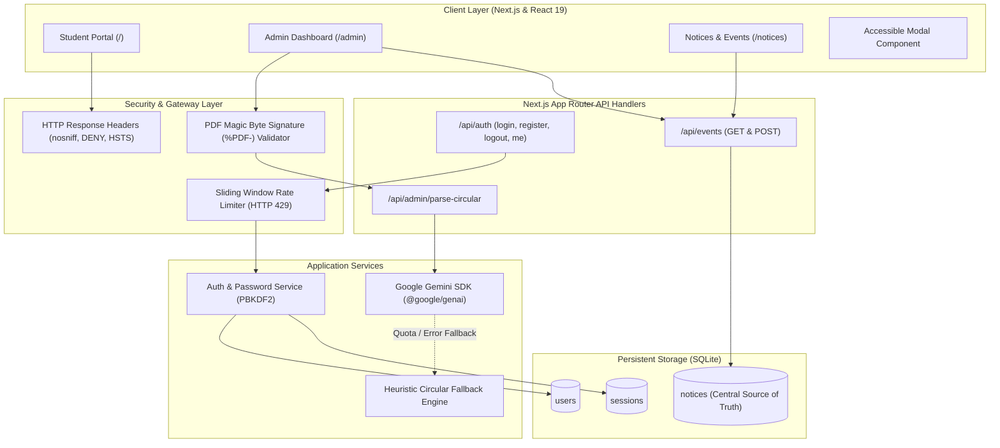

# Campus Connect AI — Smart Campus Information & Space Optimization

[](https://nextjs.org/)
[](https://react.dev/)
[](https://www.typescriptlang.org/)
[](https://tailwindcss.com/)
[](https://vitest.dev/)
[](https://ai.google.dev/)

An intelligent, accessible campus management platform designed for universities and academic institutions. Combines modern Next.js App Router full-stack capabilities, server-side Google Gemini AI document extraction, persistent SQLite data storage, and strict role-based access control.

---

## 1. Problem Statement & Main Objectives

### The Problem
1. **Information Fragmentation:** Students frequently face difficulties locating faculty cabins, checking real-time lecturer availability, identifying available classrooms, and discovering official event notices dispersed across physical bulletin boards.
2. **Classroom Underutilization:** Campus lecture halls and seminar rooms are inefficiently utilized because students and study groups lack real-time visibility into classroom timetables and vacant slots.
3. **Manual Circular Ingestion:** Official administrative notices and PDF circulars require manual transcription, leading to delays, formatting inconsistencies, and stale bulletin boards.

### Main Objectives
* **Unified Student Portal:** Provide a responsive, accessible interface for checking real-time classroom occupancy, faculty directories, campus wayfinding, and official circulars.
* **Intelligent Admin Dashboard:** Implement an AI-powered ingestion pipeline using Google Gemini (`gemini-2.5-flash`) via the official `@google/genai` SDK to automatically parse official circulars and extract structured metadata (event title, date, time, venue, coordinator, category, target audience).
* **Robust Defense-in-Depth Security:** Enforce server-managed authentication sessions, PBKDF2 password hashing with unique salts, sliding-window rate limiting (HTTP 429), PDF magic byte signature verification (`%PDF-`), and accessible modal focus management.
* **Persistent SQLite Source of Truth:** Centralize notice storage and user credentials in an embedded SQLite database using Node.js native `DatabaseSync` (`node:sqlite`) with Write-Ahead Logging (WAL) and duplicate publication rejection.

---

## 2. Key Features

### 🎓 Student Portal (`/`)
* **Live Classroom Availability (`/classrooms`):** Real-time timetable matrix and filterable vacancy tracker across campus academic blocks (Turing Block, Ramanujan Hall, Arya Hall, etc.).
* **Faculty Directory & Status (`/faculty`):** Search faculty members by department, research domain, or subject, with real-time office availability indicators and cabin locations.
* **Campus Wayfinding & Navigation (`/navigation`):** Interactive SVG campus map powered by Dijkstra's shortest-path algorithm, providing step-by-step walking directions between landmarks.
* **Official Bulletins & Notices (`/notices`):** Central bulletin board synchronized with persistent database notices, featuring category filters (Academic, Workshop, Cultural, Sports, Placement) and instant search.

### 🛡️ Administrative Dashboard (`/admin`)
* **AI-Powered Circular Parser:** Drag-and-drop PDF upload with client and server-side validation.
* **Gemini AI Extraction Engine:** Secure server-side processing using `@google/genai` to extract structured JSON metadata conforming to strict Zod schemas.
* **Resilient Fallback Mode:** Seamless offline regular expression and heuristic text parser activated automatically if API quotas or network interruptions occur.
* **Editable Preview & Verification:** Interactive modal enabling administrators to review and amend AI-extracted details prior to publishing.
* **Duplicate Submission Guard:** Rejects accidental duplicate publications (matching title and date) with HTTP 409 Conflict.

### 🔐 Authentication & Role-Based Authorization
* **Student Registration & Login (`/register`, `/login`):** Validated account registration with role escalation defenses (public registration restricted to `student`).
* **Server-Managed Sessions:** Cryptographically secure session tokens stored in HttpOnly, SameSite cookies with server-side expiry validation.
* **Brute-Force Rate Limiting:** Sliding-window rate limiter on authentication endpoints (5 attempts per 15 minutes) emitting HTTP 429 and `Retry-After` headers.
* **First-Admin Provisioning CLI:** Dedicated offline CLI script for provisioning initial administrative accounts without insecure web fallbacks.

---

## 3. Technology Stack

* **Framework:** [Next.js 16.4.0](https://nextjs.org/) (App Router, Turbopack, React Server Components)
* **Frontend Library:** [React 19.3.0](https://react.dev/)
* **Language:** [TypeScript 5.x](https://www.typescriptlang.org/) (Strict type checking)
* **Styling:** [Tailwind CSS v4](https://tailwindcss.com/) with Lucide React icons
* **Database:** Native SQLite via Node.js `node:sqlite` (`DatabaseSync`) with WAL mode
* **AI Integration:** Google Gemini 2.5 Flash via official [`@google/genai`](https://www.npmjs.com/package/@google/genai) SDK
* **Validation:** [Zod](https://zod.dev/) runtime schema validation
* **Testing:** [Vitest 5.0.3](https://vitest.dev/) (85 automated tests)

---

## 4. System Architecture



---

## 5. Installation & Setup Instructions

### Prerequisites
* **Node.js:** v20.x or v22.x+ (Recommended: Node.js v24 LTS)
* **npm:** v10.x+
* **Operating System:** Windows, macOS, or Linux

### 1. Clone the Repository
```bash
git clone https://github.com/KhushiSPoojari/campus-connect-ai.git
cd campus-connect-ai
```

### 2. Install Dependencies
```bash
npm install
```

### 3. Environment Variable Configuration
Copy the template configuration file:
```bash
cp .env.example .env.local
```
Edit `.env.local` and define the required variables:

| Variable | Description | Requirement | Example / Default |
|---|---|---|---|
| `AUTH_SECRET` | 32+ character cryptographic secret for session integrity | **Required** | Generate via `openssl rand -hex 32` |
| `GEMINI_API_KEY` | Google Gemini API key for circular extraction | **Optional** (falls back to offline parser if unset) | From [Google AI Studio](https://aistudio.google.com/) |
| `DATABASE_PATH` | File path for the persistent SQLite database | Optional | Defaults to `./data/campus-connect.db` |

> **Note:** Never prefix sensitive variables with `NEXT_PUBLIC_`. The application operates safely even if `GEMINI_API_KEY` is omitted, utilizing its internal heuristic OCR fallback parser.

### 4. Provision Initial Administrator
Execute the secure provisioning CLI script to create the first admin user:
```bash
node scripts/create-admin.mjs --email admin@campus.edu --name "Campus Administrator" --password "YourStrongPassword123!"
```
*(If no password is provided, a cryptographically secure random password will be generated and printed to the terminal.)*

---

## 6. Development & Production Commands

| Command | Action | Description |
|---|---|---|
| `npm run dev` | Start Development Server | Launches Next.js dev server at `http://localhost:3000` with Turbopack. |
| `npm run build` | Build for Production | Performs full TypeScript typecheck and compiles static/dynamic pages. |
| `npm start` | Run Production Server | Starts the optimized production build at `http://localhost:3000`. |
| `npm test` | Execute Test Suite | Runs all 85 automated Vitest unit and integration tests. |
| `npm run lint` | Run ESLint | Checks code against Next.js and TypeScript linting rules. |
| `npm run create-admin` | Admin Provisioning | Interactive CLI to provision or reset administrator credentials. |

---

## 7. Testing Instructions

The project features a comprehensive test suite covering all critical subsystems:
```bash
npm test
```

### Test Suite Coverage (85 Tests across 11 Test Suites)
* `tests/auth-and-authorization.test.ts` (32 tests): PBKDF2 hashing, session creation, role separation, unauthorized route rejection, duplicate notice rejection (409), schema validation (400), rate limiting (429), window expiry, and reset mechanics.
* `tests/admin-api-validation.test.ts` (11 tests): `%PDF-` file signature checks, oversized payload rejection (413), 0-byte file handling, Gemini extraction mocking, and quota fallback behavior.
* `tests/campus-search.test.ts` (8 tests): Global campus entity search, fuzzy ranking, query normalization.
* `tests/gemini-schema-validation.test.ts` (7 tests): Zod schema validation, date/time format checks, category validation.
* `tests/modal-accessibility.test.ts` (6 tests): Keyboard focus trapping, Tab/Shift+Tab wrapping, Escape dismissal, focus restoration, detached DOM handling.
* `tests/classroom-availability.test.ts` (5 tests): Timetable lookups, room vacancy algorithms.
* `tests/faculty-availability.test.ts` (5 tests): Faculty schedule filtering, office hours verification.
* `tests/campus-navigation.test.ts` (4 tests): Dijkstra shortest-path route calculation and edge-case handling.
* `tests/time-helpers.test.ts` (4 tests): Campus period translations, 12h/24h time format utilities.
* `tests/security-headers.test.ts` (2 tests): Declaration of security headers (`nosniff`, `DENY`, HSTS).
* `tests/smoke.test.ts` (1 test): System smoke verification.

---

## 8. Security Architecture & Deployment Notes

### Security Measures Implemented
* **Password Hashing:** Passwords hashed with Node.js `crypto.pbkdf2Sync` (SHA-512, 10,000 iterations) using cryptographically random 16-byte unique salts.
* **Timing-Safe Equality:** Password verification uses `crypto.timingSafeEqual` to eliminate timing side-channel attacks.
* **Authentication Rate Limiting:** Sliding-window rate limiter tracks requests per sanitized IP. Exceeding 5 requests per 15 minutes triggers `HTTP 429 Too Many Requests` with a `Retry-After` header. Generic error responses avoid username enumeration.
* **File Upload Hardening:** Uploaded circulars are restricted to 5 MB, validated for `.pdf` extension, and verified against the standard `%PDF-` 5-byte file header signature.
* **HTTP Security Headers:** Configured in `next.config.ts`:
  - `X-Content-Type-Options: nosniff`
  - `X-Frame-Options: DENY`
  - `Referrer-Policy: strict-origin-when-cross-origin`
  - `Permissions-Policy: camera=(), microphone=(), geolocation=()`
  - `Strict-Transport-Security: max-age=63072000; includeSubDomains; preload` (enforced in production)
* **Modal Accessibility (WCAG 2.1 AA):** Focus is trapped inside open modals, automatically directed to the first interactive element, and restored to the trigger element upon close.

### Deployment Scope & Known Boundaries
* **Single-Instance Deployment (VPS, Docker, On-Premises):** **Production Ready.** Uses embedded SQLite with WAL journal mode and in-memory rate limiting. Suitable for university intranets, department servers, or standalone virtual machines.
* **Multi-Instance / Serverless Scaling (e.g., AWS Lambda, Vercel Edge):** For horizontally autoscaled deployments across multiple instances, migrate the local SQLite database to a managed SQL database (e.g., PostgreSQL / Neon) and replace the in-memory rate limiter with a distributed store (e.g., Redis / Upstash).
